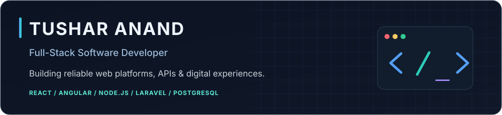
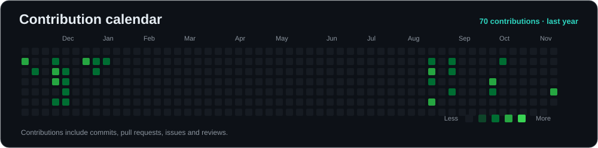
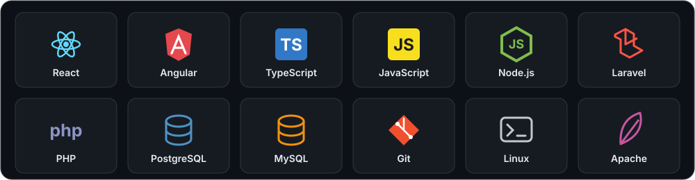
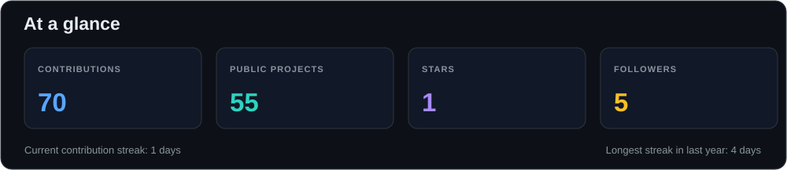
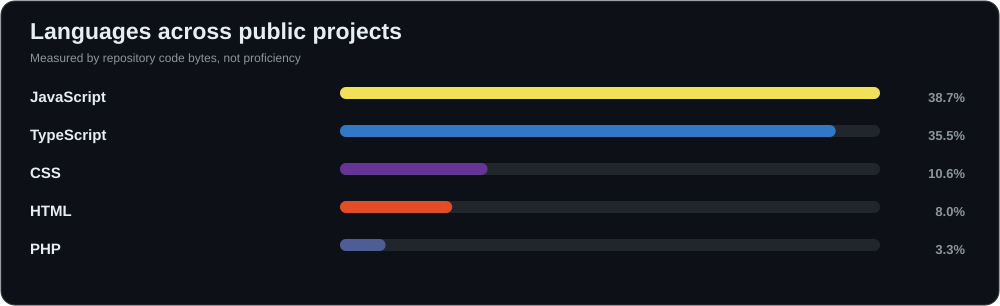

<!-- GitHub profile for @TusharAnand303. Charts are generated by the GitHub Actions workflow in this repository. -->

  

  <a href="https://itstushar.in/">Portfolio</a>
  &nbsp;·&nbsp;
  <a href="https://github.com/TusharAnand303?tab=repositories">Projects</a>
  &nbsp;·&nbsp;
  <a href="https://github.com/TusharAnand303">GitHub</a>

### 📈 GitHub activity

<!-- Generated daily from GitHub's contribution calendar, not a third-party graph image server. -->

  

  
<strong>View contribution calendar</strong>

  

### ⚡ About me

I'm **Tushar Anand**, a full-stack software developer with **6+ years of experience** building and maintaining web applications, REST APIs, content management systems, and digital public-service platforms.

I work across **React, Angular, Node.js, PHP/Laravel, TypeScript, and PostgreSQL**, including production deployments on Linux and Apache.

- 🛠️ **What I build:** End-to-end web apps, scalable APIs, CMS platforms, and practical digital services.
- 🔎 **What I value:** Clean architecture, security, performance, accessibility, and maintainability.
- 🌏 **Open to:** Permanent, full-time remote software engineering opportunities.

### 🧰 Technologies

  

Also experienced with **React Native**, REST API integration, GitHub workflows, and server troubleshooting.

### 📊 GitHub overview

  

  

**Charts refresh daily** using GitHub Actions and GitHub's API. GitHub contributions include more than commits; graphs reflect activity GitHub makes available to the token. Language percentages are based on public repository code bytes, not expertise. GitHub may cache images temporarily.

### 🚀 Work and projects

My work covers digital service applications, content publishing systems, data-driven portals, and backend integrations. Some professional projects are not publicly available.

**[Explore my public repositories](https://github.com/TusharAnand303?tab=repositories)** to see available code and experiments.

---

  <strong>Let's build something useful.</strong> 
  <a href="https://itstushar.in/">itstushar.in</a>
  &nbsp;·&nbsp;
  <a href="https://github.com/TusharAnand303">github.com/TusharAnand303</a>

